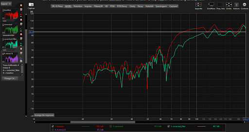
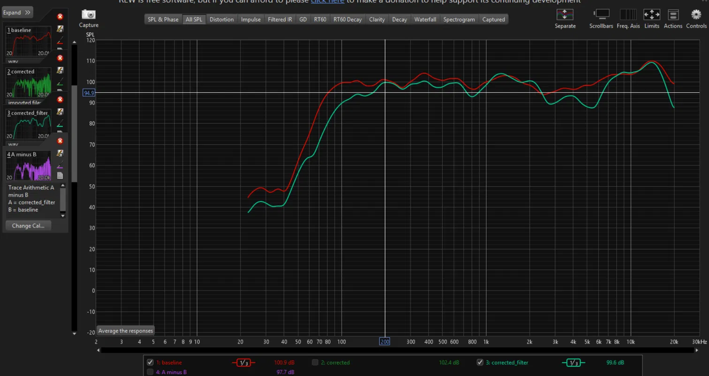
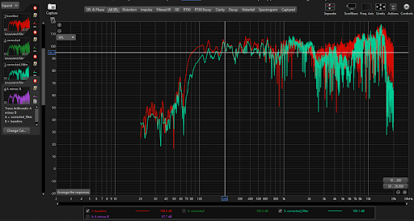
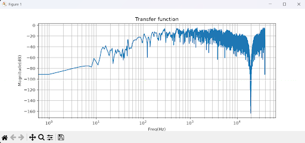
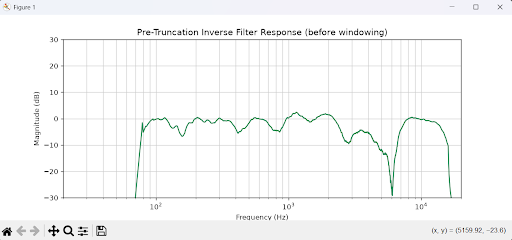
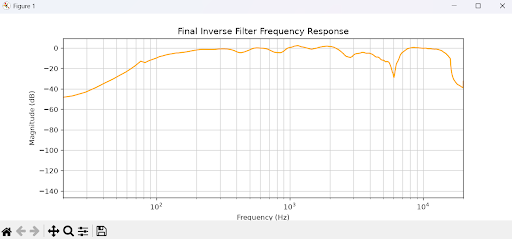

# Room Correction DSP: Python Toolchain

**Author:** Van-Dyck Adanuty

**Why this exists:** Conventional graphic EQ cannot compensate for the combined magnitude and phase distortions introduced by loudspeakers and listening environments. This project estimates the room impulse response from acoustic measurements and generates a stable inverse FIR filter suitable for real-time convolution.

This Python-based toolchain handles the processing for physical room correction. It extracts an acoustic signature from a physical space, calculates a stable inverse filter, and formats the data for zero-latency execution within a C++ (JUCE) convolution engine.

## Limitations

- Cannot correct deep destructive interference
- Assumes a linear time-invariant system
- Optimized for a single listening position
- FIR length limited to 8192 taps

## The Architecture

In digital signal processing, calculating a theoretical perfect inverse of a room yields an unstable, non-causal filter that causes pre-ringing, alters transients, and possesses a small physical sweet spot.

Bridging the gap between theoretical math and acoustic engineering requires enforcing boundaries throughout the processing chain.

To manage acoustic reflections, the raw data is truncated to focus exclusively on early reflections.

The correction strategy is split at the Schroeder frequency. This guarantees that resonant room modes and late reverberation are treated as distinct physical problems.

Mathematical pre-ringing (a side effect of phase manipulation) is attenuated through the application of custom asymmetric windowing.

Finally, out-of-band amplification is limited. The system relies on frequency-dependent denominator stabilization paired with a hard gain ceiling to lock the output strictly within safe parameters.

## Empirical Verification (REW Measurements)

Simulated diagnostics and Python-side plots easily confirm the filter is mathematically well-behaved, but they cannot confirm it alters the physical room. The only way to definitively verify acoustic performance is through a physical sweep captured before and after the plugin is inserted, measured strictly with Room EQ Wizard.

The validation relies on a direct comparison. A raw baseline trace—recorded with the convolution engine completely bypassed on the master bus—was overlaid against a corrected trace captured moments later with the inverse filter active.

These readings were evaluated entirely raw. Because the traces were not artificially level-matched post-capture, the delta between the two curves exposes the exact physical gain adjustments and phase shifts introduced by the C++ engine. This unprocessed overlay proves the ~15 dB reduction in the targeted 50 Hz modal null, demonstrating that the mathematics successfully translated into physical reality.

_Baseline vs. corrected, 10–200 Hz, no smoothing. This view actually proves modal correction: the baseline drops to roughly 18 dB in the sharp, narrow null at 50 Hz, while the corrected trace only dips to roughly 33–35 dB at the same frequency. This shows about 15 dB of null-fill at the exact frequency the original REW diagnostic flagged as a problem. Smoothed views blur this entirely, making this unsmoothed comparison the required evidence._

_Baseline vs. corrected, full spectrum, 1/3-octave smoothed. Because this is roughly matched to the frequency resolution of human hearing, it is highly useful for judging overall tonal balance rather than narrow modal features. The corrected trace tracks visibly below baseline through the 40–100 Hz hump and again through part of the 1–3 kHz range, which is consistent with an overall gentler, flatter response._

_Baseline vs. corrected across the full audible range. Above roughly 9 kHz, the corrected trace stays visibly lower and less jagged than the raw comb-filtered baseline. This is heavily consistent with the 1/3-octave smoothing bypass boundary and the conservative high-frequency beta value taming the uncorrectable comb nulls rather than trying to chase them._

The smoothing setting and zoom window matter enormously for what a given plot can and cannot prove. An unsmoothed and narrow zoom is inherently required to see modal nulls, while 1/3-octave smoothing is appropriate for tonal-balance claims but will hide the exact things narrow-null claims depend on.

## Acoustic Ingestion & Time Alignment

First, the physical room is translated into pure mathematical data. Room EQ Wizard (REW) handles the acoustic capture by playing the logarithmic sine sweep, recording the space, and performing the initial deconvolution. The Python toolchain simply ingests this resulting raw impulse response file as its foundational starting point.

Before transitioning into the frequency domain, the raw data must be physically grounded. The script locates the exact sample where the speaker's direct sound hits the measurement microphone. That specific peak is aligned to index 0, and the remaining acoustic tail is circularly wrapped to the back of the array.

This crucial alignment mathematically treats the direct sound as arriving exactly at $t=0$. Executing this shift prior to the Real FFT prevents numerical instability. It preserves the integrity of the sharp physical transient instead of letting high frequencies wrap across the spectrum.

Once aligned, the time-domain array is converted into complex frequency data. Baseline verification of the raw REW capture—with all master-bus effects bypassed—exposed the room's physical behavior. The data revealed high-Q sub-bass resonant modes below roughly 80 Hz and dense comb filtering above it. That empirical boundary defines the Schroeder frequency used in the next processing stage.

## Selective Fractional-Octave Smoothing

Raw high-frequency data is heavily dominated by comb filtering, manifesting as hundreds of uncorrectable peaks and nulls caused by direct sound colliding with early reflections. Attempting to invert these anomalies directly would mean chasing noise rather than correcting the room.

To resolve this, complex frequency-domain values are averaged in 1/3-octave bands. This process flattens amplitude and phase wraps into a broader, more manageable acoustic trend.

Crucially, this smoothing is explicitly bypassed below the approximate 80 Hz Schroeder frequency and above 20 kHz. Below the Schroeder point, the room behaves as a small number of distinct, high-Q resonant modes. Smoothing them away would permanently erase the exact frequencies that require surgical correction. Above 20 kHz, there is simply nothing meaningful left to smooth. This selective-bypass logic serves as the dividing line between raw bass inversion and smoothed treble inversion, ensuring that two very different acoustic regimes receive specialized treatment.

## Mathematical Inversion (Kirkeby)

Once the selectively smoothed room impulse response is extracted, the engine calculates the exact counter-frequencies necessary to neutralize it. In a standard academic DSP environment, the inverse transfer function is taught as a straightforward equation:

$$H_{inv}=\frac{1}{H_{room}}$$

Applying this ideal inverse to a physical room results in severe clipping because real rooms have deep acoustic nulls where frequencies cancel each other out. If the microphone captures near-zero energy at 150 Hz, the theoretical formula attempts to divide by zero, demanding infinite gain from the speakers.

To compensate for this, the algorithm employs Kirkeby Regularization to calculate a least-squares optimized inverse filter:

$$H_{inv}=\frac{H_{room}^*}{\lvert H_{room}\rvert^2+\beta(f)}$$

The first working version of this pipeline used a single flat beta constant of 0.1 everywhere, which provided a safe floor but acted as a static limit that reduced precision in the midrange. The current implementation replaces that flat constant with a dynamic, frequency-dependent beta array. At the extremes—the deep sub-bass and ultra-treble—the beta value is set to approximately 0.1 because these regions contain mostly uncorrectable acoustic nulls, keeping the filter deliberately conservative to prevent excessive gain. Conversely, a lighter touch of roughly 0.005 is applied through the midrange, allowing the filter to make precise corrections where the room's behavior is well-defined.

As a final failsafe independent of the Kirkeby math, the anchored magnitude output is passed through a hard +12 dB maximum boost ceiling via clipping. Regardless of what the beta array allows upstream, no single frequency can be amplified past this ceiling.

## The Physical-Digital Boundary

The raw output of the Kirkeby inversion is mathematically correct but physically unusable due to wrap-around artifacts, destructive pre-ringing, and uncorrectable late reverberation. These are the steps to solve these issues:

First, the raw inverted signal is truncated to 8192 samples, roughly equivalent to 185 milliseconds. This length is carefully split into 1024 pre-transient samples and 7168 post-transient samples. Because sound travels about one foot per millisecond, correcting a full second of late reverberation creates a filter with a limited spatial sweet spot; moving your head an inch breaks the phase correction entirely. Truncating to the direct sound and early reflections maximizes the sweet spot while keeping CPU overhead minimal. The exact split was chosen so the total lands precisely on the 8192-sample power-of-two boundary, which boosts SIMD-aligned convolution performance in the real-time C++ engine.

Second, a circular time shift is applied. Since FFT operations assume circular, infinitely looping signals, the Kirkeby output wraps negative time data around to the end of the array. The array is rolled to drag this wrapped data back to the center, realigning the main Dirac spike onto a linear timeline.

Finally, an asymmetric Hanning window is applied to maintain transient clarity. Phase correction inherently requires pre-ringing, which is energy that occurs before the main sound. To prevent transients from sounding metallic, an asymmetric window provides a tailored solution. The 1024-sample left side acts as a gate, rapidly scaling from zero to one to attenuate pre-ringing right up until the microsecond the physical transient hits. The 7168-sample right side acts as a gentle release that smoothly curves from one to zero, allowing the physical tail of the room to ring out naturally while preventing DC offsets and spectral leakage.

## JUCE C++ Export Compliance

The final filter must be ingested by the JUCE convolution engine, which enforces strict constraints via its internal memory parser. The Python script formats the data to guarantee static binary compilation.

The one-dimensional mono filter is vertically stacked into an 8192 by 2 matrix to fulfill the stereo contract of the C++ convolver. This stereo matrix is subsequently cast to a 32-bit float to preserve the structural integrity of the FIR coefficients natively without requiring destructive integer scaling or quantization. A dynamic safety guard then checks the array, guaranteeing the filter is peak-normalized to prevent mathematical clipping during live sum-of-products convolution.

The script finalizes the process by generating a standalone correction filter WAV file. This file is not intended to be read from a file system at runtime; rather, it is designed to be injected directly into the VST3 binary via the CMake binary data module, effectively turning the mathematical array into a hardcoded C++ memory block.

## Filter Characteristics

These plots trace the inverse filter through its own generation pipeline, from raw mathematical inversion to the final windowed, truncated version that ships inside the plugin.

_The raw transfer function of the room, prior to any correction, serves as the mathematical starting point the Kirkeby inversion works against._

_The inverse filter's frequency response before windowing and truncation are applied highlights the instability creeping in at the sub-20 kHz edge. This is exactly the kind of unbounded behavior that Phase 4's asymmetric Hanning window and the +12 dB brickwall ceiling exist to tame._

_The final 8192-sample filter after windowing, truncation, and the brickwall ceiling demonstrates what actually gets baked into the WAV file and injected into the JUCE binary._

## Engineering Challenges

Building a DSP pipeline that spans from theoretical Python math to real-time C++ execution required navigating mathematical and architectural challenges.

The time-domain truncation trap initially led to heavily lost sub-bass. While the pre-truncation diagnostic plot showed perfect sub-bass extension, the final exported C++ convolution slice choked the low frequencies into a flattened floor instead of making the required modal cuts. The root cause was discovered in the pre-transient length, which was originally set to a mere 44 samples. Because a 40 Hz wave needs about 25 milliseconds to complete a single cycle, the tight window was unintentionally acting as a hard high-pass filter. This chopped off the correction tails needed for low-frequency phase manipulation. It was permanently fixed by widening the pre-transient length to 1024 samples, successfully capturing the full physical wavelengths of the sub-bass modes.

Expanding the time-domain window arbitrarily introduced a new hardware optimization constraint. It risked unpredictable CPU load spikes during real-time DAW playback since convolution engines process SIMD instructions most efficiently at aligned buffer boundaries. This was resolved by locking the lengths to an exact 8192-sample total block, safely hitting a power-of-two boundary for CPU cache alignment at the cost of an acceptable latency of about 23 milliseconds.

During early C++ integration, the convolution engine exhibited a passthrough anomaly where the JUCE convolver completely ignored the impulse response. This was isolated to a channel mismatch because the Python script was exporting a one-channel mono array, strictly violating the stereo requirement of the C++ engine. Stacking the array vertically resolved the bypass immediately. Similarly, a normalization safety guard silently failed because the raw Kirkeby output naturally falls well below an amplitude of 1.0. This guard was corrected to trigger dynamically for values greater than zero, guaranteeing consistent peak normalization regardless of the initial input scale.

Early mathematical development featured numerical instability caused by the regularization epsilon. An epsilon of 1e-10 was initially used during deconvolution, but this proved mathematically too small and caused high-frequency energy to exhibit numerical instability in regions where the sweep lacked physical acoustic energy. Increasing the threshold stabilized the frequency boundaries.

Finally, none of this pipeline could be validated by code review alone. It had to be thoroughly verified against Room EQ Wizard's complex SPL, group delay, spectrogram, waterfall, and RT60 plots. Early on, this meant struggling to differentiate a genuine room mode from a measurement artifact, or a meaningful gain spike from acceptable inversion noise. This was resolved by working through each plot type in sequence against known-good reference behavior until the graphs started directly dictating design decisions. The REW diagnostic is precisely what confirmed correct modal correction and separately surfaced the broadband gain floor, the 200–400 Hz gain spike, and the high-frequency inversion noise that originally motivated the move to a frequency-dependent beta array.

## Lessons Learned

Beyond the codebase, engineering this pipeline forced a shift from theoretical mathematics to applied DSP engineering. Analyzing a single FFT plot is now fully sufficient to identify physical acoustic nulls, hazardous out-of-band energy, and the exact bandwidth limitations of the hardware without needing a comparative reference.

While DSP windowing is standard academic theory, calculating a mathematically perfect, non-causal inverse filter demonstrated exactly why windowing is mandatory in the physical world. Encountering metallic pre-ringing provided the exact context needed. By splicing an asymmetric Hanning window using a steep left ramp as a gate and a gentle right slope to respect physical room decay, windowing was effectively transformed from an abstract textbook formula into a deeply understandable engineering tool.

Coming from a traditional DSP academic background, the concept of system inversion was understood strictly through the lens of ideal transfer functions.

$$H_{inv}=\frac{1}{Y(s)}$$

Running that exact classroom theory into a physical audio engine and watching it fail—hitting acoustic nulls and overloading the convolution engine with infinite gain—forced a complete re-evaluation of the math. Utilizing Kirkeby Regularization, and subsequently moving from a flat scalar to a dynamic, frequency-dependent beta array, provided the necessary mechanics to ground classroom theory into acoustic reality.
